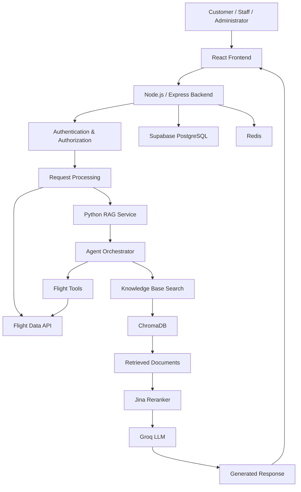
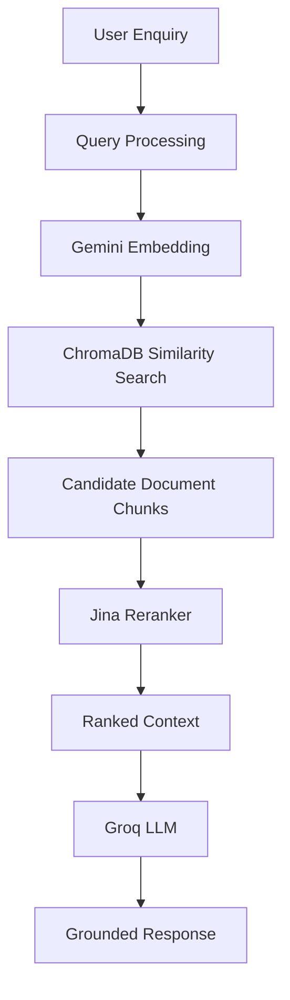

# Airline Support Assistant

## Overview

The Airline Support Assistant is an AI-powered application developed to support airline customers and staff by providing context-aware responses to enquiries about airline policies, procedures and flight operations.

The system combines **Retrieval-Augmented Generation (RAG)** with an agent-based architecture. An Agent Orchestrator determines how each request should be handled by selecting between direct conversational responses, knowledge-base retrieval and flight-related API tools.

For knowledge-based enquiries, the system retrieves relevant information from a curated airline knowledge base before generating responses. For flight-related enquiries, it uses external flight data services to retrieve operational information. Role-based access controls ensure that users can only retrieve information they are authorised to access.

**Live Application:** https://airline-support-frontend.onrender.com/

**Staff & Administrator Portal:** https://airline-support-frontend.onrender.com/login

## Objectives

The project aims to:

- Develop an intelligent assistant for airline customer and staff support.
- Implement an agent-driven architecture for handling different types of user enquiries.
- Develop a RAG pipeline for retrieving relevant information from airline knowledge sources.
- Improve response reliability by grounding generated answers in retrieved information.
- Integrate external flight data APIs for flight searches, schedules and status enquiries.
- Implement role-based access control for customer, staff and knowledge base administrator accounts.
- Explore the practical application of Large Language Models and agent-based systems in airline support services.

## Key Features

- **Agent Orchestration:** Determines whether a request requires a direct response, knowledge-base retrieval or flight-related API operations.
- **Knowledge Base Retrieval:** Retrieves relevant document chunks using semantic similarity search.
- **Document Reranking:** Reorders retrieved chunks based on their relevance to the user's query.
- **Flight Search:** Retrieves flight options using an external flight data API.
- **Flight Schedules:** Provides flight schedule information.
- **Flight Status:** Retrieves operational flight status information.
- **Role-Based Access Control:** Applies user permissions when accessing restricted knowledge base content.
- **Conversational Interface:** Supports multi-turn conversations using conversation history.
- **Knowledge Base Management:** Allows authorised administrators to manage knowledge base content.
- **User Feedback:** Allows users to submit ratings on chatbot responses.

### Agent Tools

The Agent Orchestrator uses specialized tools to perform operations when required.

| Tool                    | Responsibility                                                  |
| ----------------------- | --------------------------------------------------------------- |
| `knowledge_base_search` | Retrieves relevant information from the airline knowledge base. |
| `flight_search`         | Searches for flight options using the flight data API.          |
| `flight_schedule`       | Retrieves flight schedule information.                          |
| `flight_status`         | Retrieves flight status information.                            |

The orchestrator determines which tool is appropriate for an enquiry and can perform multiple tool calls when necessary. A maximum iteration limit is configured to control agent execution.

## Technology Stack

### Frontend

- React
- Tailwind CSS
- Axios

### Application Backend

- Node.js
- Express.js
- Sequelize ORM

### RAG Service

- Python
- Flask
- ChromaDB
- PyMuPDF4LLM

### AI and Machine Learning

- **LLM:** Groq – `openai/gpt-oss-120b`
- **Embedding Model:** Gemini Embedding 2
- **Reranking Model:** Jina Reranker v2 Base Multilingual

### External APIs

- OAG Flight Data API
- Google Gemini API
- Groq API
- Jina AI API

### Database and Storage

- Supabase PostgreSQL
- Redis
- ChromaDB

### DevOps and Deployment

- Docker
- Docker Compose
- Git
- GitHub
- GitHub Actions
- Render

## System Architecture

The local development application consists of five containerised services:

| Service             | Responsibility                                                                 |
| ------------------- | ------------------------------------------------------------------------------ |
| Frontend            | Provides the user interface.                                                   |
| Application Backend | Handles API requests, authentication, permissions and application logic.       |
| Email Worker        | Processes background email tasks.                                              |
| RAG Service         | Handles knowledge-base retrieval, agent orchestration and response generation. |
| RAG Worker          | Processes background knowledge-base ingestion and deletion tasks.              |

The frontend communicates with the application backend, which coordinates requests with the RAG service and external flight data APIs. Redis supports session management, conversation context and background task processing, while Supabase PostgreSQL stores application data. ChromaDB stores the indexed document embeddings and associated metadata.

### Application Architecture



## Agent Orchestration

The application uses an Agent Orchestrator to determine how incoming enquiries should be handled.

Instead of sending every request through the same retrieval pipeline, the orchestrator selects the appropriate approach based on the user's enquiry.

### Request Handling

1. The user submits an enquiry through the frontend.
2. The application backend processes the request and provides the appropriate user permissions and conversation context.
3. The Agent Orchestrator analyses the enquiry.
4. It determines whether the request can be answered directly, requires knowledge-base retrieval or requires a flight-related tool.
5. Selected tools are executed and their results returned to the orchestrator.
6. Where knowledge retrieval is required, relevant documents are retrieved and reranked.
7. The LLM generates the response using the available context and tool results.
8. The response is returned to the frontend.

### Available Agent Tools

| Tool                    | Description                                                     |
| ----------------------- | --------------------------------------------------------------- |
| `knowledge_base_search` | Searches the knowledge base for relevant airline information.   |
| `flight_search`         | Retrieves flight options based on the requested travel details. |
| `flight_schedule`       | Retrieves scheduled flight information.                         |
| `flight_status`         | Retrieves flight operational information.                       |

The orchestrator supports iterative tool execution with a maximum iteration limit to prevent uncontrolled tool loops.

## Retrieval-Augmented Generation (RAG)

The RAG pipeline enables the application to answer knowledge-based enquiries using information from the curated airline knowledge base rather than relying exclusively on the LLM's pretrained knowledge.

### Retrieval Pipeline



### Retrieval Process

1. The user enquiry is converted into an embedding representation.
2. ChromaDB performs semantic similarity search against the stored document embeddings.
3. Candidate document chunks are retrieved.
4. The Jina reranker evaluates the retrieved candidates against the query and reorders them by relevance.
5. The highest-ranked chunks are selected as context for response generation.
6. The LLM generates a response grounded in the retrieved context.

### Retrieval Components

| Component       | Technology                         |
| --------------- | ---------------------------------- |
| Embedding Model | Gemini Embedding 2                 |
| Vector Database | ChromaDB                           |
| Reranker        | Jina Reranker v2 Base Multilingual |
| LLM             | Groq `openai/gpt-oss-120b`         |

### Conversation Context

The system supports multi-turn conversations by maintaining conversation history and providing relevant context during request processing.

This allows the assistant to interpret follow-up enquiries without treating each message as an entirely independent request.

## Knowledge Base

The knowledge base contains airline support information sourced from the official Kenya Airways website.

### Knowledge Base Dataset

The dataset consists of 30 Markdown documents organized into the following categories:

| Category           | Documents |
| ------------------ | --------: |
| Airport Services   |         1 |
| Baggage            |         7 |
| Flight Bookings    |         7 |
| Check-in           |         5 |
| Flight Disruptions |         2 |
| Special Assistance |         5 |
| Travel Services    |         3 |
| **Total**          |    **30** |

Each document contains structured metadata used to identify and manage its content, including:

- Document ID
- Origin
- Document type
- Applicability
- Access level
- Status
- Language

### Document Processing

Documents are processed using Markdown-aware splitting followed by recursive character splitting.

| Parameter          | Value            |
| ------------------ | ---------------- |
| Markdown splitting | Header-based     |
| Header levels      | H1, H2, H3       |
| Chunk size         | 1,000 characters |
| Chunk overlap      | 200 characters   |

The resulting chunks are embedded and stored in ChromaDB along with their associated metadata.

### Vector Store

The application uses a pre-generated ChromaDB vector store for the deployed environment. The vector store is prepared during knowledge base processing and packaged with the RAG service Docker image.

The production RAG service loads the prebuilt vector store for retrieval, eliminating the need to run knowledge base ingestion workers continuously in the deployed environment.

## Flight Information Integration

The application integrates with the OAG Flight Data API to support flight-related enquiries.

The flight tools enable the agent to retrieve information for:

- Flight searches
- Flight schedules
- Flight status

The Agent Orchestrator selects the appropriate flight tool based on the enquiry and uses the returned information when generating its response.

## Role-Based Access Control

The application implements role-based access control to manage access to protected functionality and knowledge base information.

### Roles

| Role                 | Description                                                                      |
| -------------------- | -------------------------------------------------------------------------------- |
| CUSTOMER             | Access to public customer support functionality.                                 |
| STAFF                | Access to authorized staff functionality and information.                        |
| KNOWLEDGE_BASE_ADMIN | Access to knowledge base administration and authorized management functionality. |

### Group-Based Permission Management

The system supports group-based permission management, allowing permissions to be assigned to groups and staff users to be associated with those groups.

Knowledge Base Administrators can:

- Create and manage staff groups.
- Create and manage permissions.
- Assign permissions to groups.
- Add staff users to groups.
- Manage staff access through group membership.

The application backend provides the authorization context to the RAG service. Access restrictions are enforced using trusted backend-provided permissions rather than permissions supplied by the LLM or the user.

### Staff Invitation Workflow

Knowledge Base Administrators can invite staff members to create accounts.

The invitation workflow allows staff account creation through an authorized invitation process, rather than unrestricted staff registration.

## Knowledge Base Administration

The system provides administrative functionality for managing knowledge base content and staff access.

Knowledge Base Administrators can:

- Manage knowledge base documents.
- Manage staff groups.
- Manage permissions.
- Assign permissions to groups.
- Manage staff group membership.
- Invite staff members.
- View chatbot feedback and analytics.

## User Feedback and Analytics

The application provides feedback functionality that allows users to rate chatbot responses.

Feedback and query information are stored by the application and made available to authorized knowledge base administrators through the dashboard.

The dashboard provides visibility into chatbot usage and user feedback to support monitoring and knowledge base improvement.

## Deployment

The application is publicly hosted on **Render**, with the frontend, application backend and RAG service deployed as separate Docker-based services.

The application uses Supabase PostgreSQL and cloud-hosted Redis for its external data and session management infrastructure.

The production deployment excludes the RAG background ingestion and deletion workers to reduce deployment resource consumption and costs. A pre-generated ChromaDB vector store is packaged with the RAG service image and loaded for retrieval.

Knowledge base updates therefore require regenerating the vector store and redeploying the RAG service.

**Access the deployed application:**

https://airline-support-frontend.onrender.com/

### Production Services

| Service                          | Deployment                             |
| -------------------------------- | -------------------------------------- |
| Frontend                         | Render                                 |
| Application Backend              | Render                                 |
| RAG Service                      | Render                                 |
| PostgreSQL Database              | Supabase                               |
| Session and Conversation Context | Cloud Redis                            |
| Vector Database                  | ChromaDB packaged with the RAG service |

## Evaluation Access

The deployed application provides evaluation accounts for testing staff and knowledge base administration functionality.

| Role                         | Email                       |
| ---------------------------- | --------------------------- |
| Staff                        | `staff1.local@example.test` |
| Staff                        | `staff2.local@example.test` |
| Knowledge Base Administrator | `kba.local@example.test`    |

All three evaluation accounts share the same initial password, which is provided separately to authorized evaluators.

**Staff and Administrator Login Portal:**

https://airline-support-frontend.onrender.com/login

These accounts are intended for project evaluation purposes only.

## Local Development and Setup

The repository includes Dockerfiles, a Docker Compose configuration and automated setup scripts to simplify local deployment.

### Prerequisites

- Git
- Docker Engine
- Docker Compose

For Windows, Docker Desktop can be used to provide Docker Engine and Docker Compose.

Linux users require Docker Engine and the Docker Compose plugin, as well as `curl` and `unzip`.

### 1. Clone the Repository

```bash
git clone https://github.com/Gibitoleon/airline-support-bot.git
cd airline-support-bot
```

### 2. Configure Environment Variables

The repository provides `.env.example` templates in four locations:

- Project root
- `frontend/`
- `backend/application-backend/`
- `backend/rag-service/`

Obtain the required credentials for the external services, populate the respective templates and save them as `.env` files in their corresponding directories.

**Important:** Do not commit actual environment files or expose API keys, database credentials or other secrets in the repository.

### 3. Run the Deployment Script

The automated setup scripts handle the initial deployment process.

**Windows PowerShell:**

```powershell
.\scripts\setup.ps1
```

**Linux:**

```bash
bash scripts/setup.sh
```

The scripts:

1. Verify Docker prerequisites and required environment files.
2. Download the populated ChromaDB vector store from the project's GitHub Release.
3. Extract the vector store into the required directory.
4. Build the Docker images.
5. Execute the Sequelize database migrations.
6. Start the application services using Docker Compose.

### 4. Populate Initial Database Data

For a fresh database installation, run the following command after the deployment script has completed:

```bash
docker compose exec application-backend npx sequelize-cli db:seed:all
```

This populates the initial application data, including roles, groups, permissions and local test accounts.

### 5. Verify the Services

Check the running containers:

```bash
docker compose ps
```

Once the services are running, access the frontend at:

```text
http://localhost:5173
```

Submit a chatbot enquiry to verify that the application is communicating with the backend and RAG service.

## System Configuration

The application requires environment variables to configure service communication, database connections, authentication, email processing and external API integrations.

The provided `.env.example` templates contain the required environment variable structure for each service.

The application uses environment variables for:

- PostgreSQL database connection.
- Redis connection and authentication.
- Session security.
- Frontend and backend communication.
- RAG service communication.
- Gemini API.
- Groq API.
- Jina API.
- OAG Flight Data API.
- Email delivery configuration.

Credentials must be configured locally and must not be committed to the repository.

## Background Processing

The local development environment includes background workers for email processing and knowledge base operations.

### Email Worker

Processes background email tasks, including application email workflows.

### RAG Worker

Processes queued knowledge base ingestion and deletion tasks.

The RAG worker uses Redis-backed task queues to process document operations independently of the main RAG service.

The production deployment does not run the knowledge base background workers. The pre-generated vector store is used instead to support retrieval.

## Project Status

**Implementation and deployment completed.**

The application has been implemented, containerised using Docker and Docker Compose, and publicly deployed on Render.

The system includes agent orchestration, knowledge-base retrieval, document reranking, flight API integration, authentication and role-based access control.

## Repository

GitHub: https://github.com/Gibitoleon/airline-support-bot
